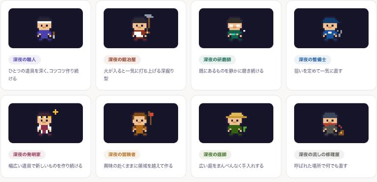

# pixel-folks

エンジニアのための16×16ドット絵キャラクター集。職人・鍛冶屋・研磨師・整備士・発明家・冒険者・庭師・流しの修理屋の8キャラを、**依存ゼロの単一ファイル**で提供します。

- **React / SVG文字列 / canvasピクセル** の3形態で同じキャラが使える
- SVGに完全インライン化されるため、**GitHubのREADME(camoプロキシ経由)でも確実に描画**される
- MIT License。改変・商用利用OK



## 使い方

`src/sprites.tsx` をプロジェクトにコピーしてください(npm installは不要の思想です)。

```tsx
// React
import { TypeSprite } from "./sprites";
<TypeSprite archetypeKey="steady-deep-builder-day" size={64} />

// SVG文字列(README用カード・OGP画像などサーバー側生成に)
import { spriteSvg } from "./sprites";
const rects = spriteSvg("sprint-deep-builder", 6.5, 10, 10);

// canvas
import { spritePixels } from "./sprites";
for (const p of spritePixels("steady-versatile-refiner")) {
  ctx.fillStyle = p.color;
  ctx.fillRect(p.x * cell, p.y * cell, cell, cell);
}
```

## キャラクター

| key | 名前 | モチーフ |
|---|---|---|
| steady-deep-builder | 職人 | 鉢巻と鑿 |
| sprint-deep-builder | 鍛冶屋 | 大ハンマーとエプロン |
| steady-deep-refiner | 研磨師 | 光る眼鏡と宝石 |
| sprint-deep-refiner | 整備士 | キャップとレンチ |
| steady-versatile-builder | 発明家 | ゴーグルと白衣と電球 |
| sprint-versatile-builder | 冒険者 | フードと旗 |
| steady-versatile-refiner | 庭師 | 麦わら帽と双葉 |
| sprint-versatile-refiner | 流しの修理屋 | ニット帽と工具箱 |

キー末尾に `-night` / `-day` を付けた16バリアントで参照できます(描画は同一、文脈側でテーマを変える想定)。

## 誕生の経緯

[Folio](https://folio.akima-inc.co.jp) — GitHubをエンジニアの営業ページに変える無料サービス — の16タイプ判定キャラとして生まれました。タイプ判定ロジックは [dev-archetype](https://github.com/masamune0625/dev-archetype) にあります。
